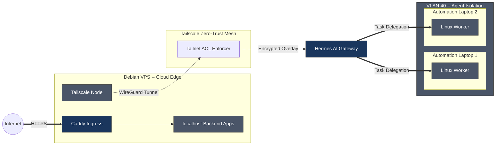

# Cloud Edge Automation


> Hardened Debian VPS mesh behind Caddy reverse proxy, running a Tailscale-over-WireGuard fabric for zero-trust service isolation. Delegated task execution across isolated Linux worker nodes restricted to a segregated agent VLAN, orchestrated from an automation laptop over an encrypted mesh tunnel.

## Architecture



> [!IMPORTANT]
> The Caddy reverse proxy **terminates TLS** at the VPS edge. Tailscale traffic for automation and worker-node orchestration **must never egress the VPS public interface**. Verify `tailscale0` is bound to the WireGuard tunnel interface, not `eth0`.

## Deployment

### 1. VPS Hardening — Baseline

```bash
# Non-root user + SSH key-only auth
adduser ops
usermod -aG sudo ops

# Lock down sshd
sed -i \
  -e 's/^#PermitRootLogin.*/PermitRootLogin prohibit-password/' \
  -e 's/^#PasswordAuthentication.*/PasswordAuthentication no/' \
  -e 's/^#PubkeyAuthentication.*/PubkeyAuthentication yes/' \
  /etc/ssh/sshd_config
systemctl restart sshd

# ufw
ufw default deny incoming
ufw default allow outgoing
ufw allow in on wg0 to any port 443 proto tcp  # Caddy via WireGuard
ufw allow in on wg0 to any port 22 proto tcp   # SSH via WireGuard
ufw enable
```

### 2. Caddy Reverse Proxy — Caddyfile

```caddy
# /etc/caddy/Caddyfile
*.ops.example.com {
    tls {
        issuer acme
    }

    # Route to internal service
    handle @api {
        reverse_proxy 10.0.10.2:8080 {
            header_up Host {host}
            header_up X-Real-IP {remotehost}
        }
    }

    handle @app {
        reverse_proxy 10.0.10.3:3000
    }

    # Deny all other subdomain routes
    handle {
        respond 404
    }

    log {
        output file /var/log/caddy/access.log
        format json
    }
}

# Internal healthcheck (no external exposure)
:9090 {
    bind 10.0.10.1
    respond /health 200
}
```

> [!NOTE]
> Use `caddy reload` after every Caddyfile change — never `restart` during active TLS handoffs. Caddy's zero-downtime reload re-reads the config without dropping connections.

### 3. Tailscale Mesh — ACL Configuration

```bash
# Install Tailscale
curl -fsSL https://tailscale.com/install.sh | sh

# Auth (headless)
sudo tailscale up --authkey=<REDACTED_SECRET> --advertise-routes=10.0.40.0/24

# ACLs via Tailscale admin UI or ACL file:
cat > /etc/tailscale/acl.json <<'EOF'
{
  "acls": [
    {
      "action": "accept",
      "src": ["10.0.40.0/24"],
      "dst": ["*:443"],
      "description": "Worker nodes -> internet outbound"
    },
    {
      "action": "deny",
      "src": ["*"],
      "dst": ["10.0.40.0/24"],
      "description": "Default deny inbound to agent VLAN"
    },
    {
      "action": "accept",
      "src": ["100.64.0.10"],
      "dst": ["10.0.40.0/24:*"],
      "description": "Automation laptop -> agent VLAN"
    }
  ]
}
EOF
```

### 4. Hermes Worker Node Isolation

```bash
# Each worker node runs on Tailscale with no open ports
# Hermes connects via delegate_task over the mesh
# Verified by:

tailscale status | grep worker
# Output:
# worker-01    10.0.40.2/24  direct    idle
# worker-02    10.0.40.3/24  direct    idle

# Confirm port scan returns nothing:
nmap -Pn 10.0.40.2
# All 1000 scanned ports are filtered
```

> [!WARNING]
> If your VPS provider assigns a public /64 IPv6 range, **remove `accept_routes` from applications that don't need it** — Tailscale may advertise your public IPv6 block into the mesh, breaking the isolation model. Explicitly scope routes in `tailscale up --advertise-routes=10.0.40.0/24,fd00::/8`.

## Verification

```bash
# Confirm Caddy is serving only over WireGuard
ss -tlnp | grep 443
# Expected: LISTEN at 10.0.10.1:443 (not 0.0.0.0:443)

# Check Tailscale mesh connectivity
tailscale ping worker-01

# Validate no public endpoint exposure
curl -s --connect-timeout 3 https://checkip.amazonaws.com  # OK (outbound works)
curl -s http://203.0.113.50   # must timeout (no public listener)
```